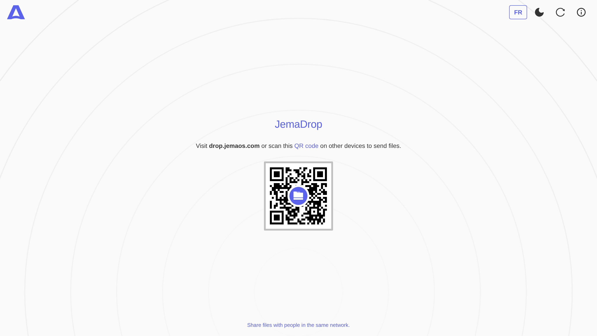
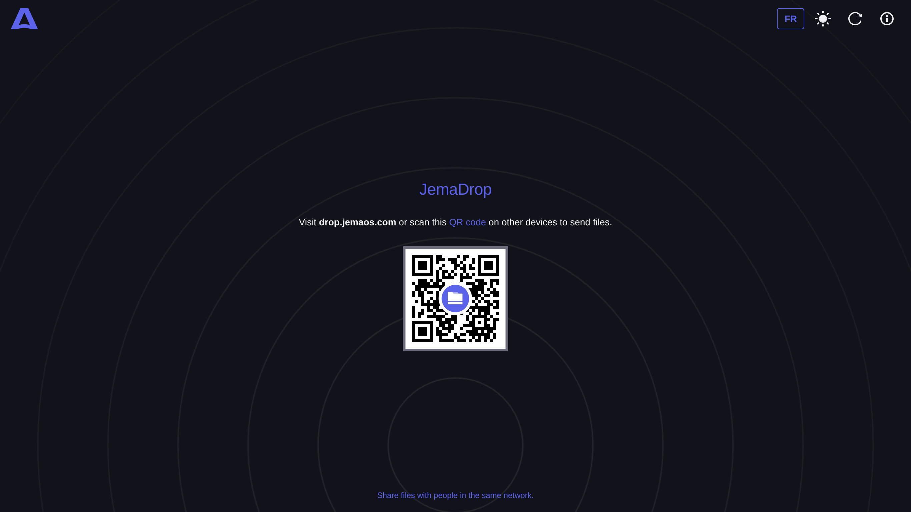

<div align="center">

<h1>JemaDrop</h1>

### Instant, peer-to-peer file sharing on your local network — no cloud, no upload

[](https://www.jematechnology.fr)
[](LICENSE)
[](https://webrtc.org)
[](https://developer.mozilla.org/en-US/docs/Web/API/WebSockets_API)
[](#)
[](#-contributing)

**Scan a QR code · send files device-to-device · files never touch a server**

[Features](#-features) · [Screenshots](#-screenshots) · [Getting started](#-getting-started) · [How it works](#-how-it-works) · [License](#-license)

<br>

<sub>**Keywords:** file sharing · peer-to-peer · P2P · local network transfer · LAN file transfer · AirDrop alternative · Snapdrop · WebRTC · WebSockets signaling · QR code · drag and drop · no cloud · no upload · device to device · self-hosted · Docker · installable PWA</sub>

</div>



---

## ✨ Features

- 📱 **Same-network transfer** — peers on the same public IP form a room
- 🔐 **Direct P2P** — files travel only between devices (WebRTC); the server is used for signaling only
- 🧭 **QR code** — scan to open JemaDrop on another device instantly
- 🖱️ **Drag & drop** — no size limits imposed by an upload server
- 🌗 **Light / dark** theme
- 🌍 **Multi-language** UI
- 📶 **Installable PWA**
- 🧱 **Self-hostable** with Docker

> JemaDrop is a fork of [Snapdrop](https://github.com/RobinLinus/snapdrop), adapted for JemaOS.

---

## 📸 Screenshots

| Light | Dark |
| :---: | :---: |
|  |  |

---

## 🚀 Getting started

### Docker (recommended)

```bash
git clone https://github.com/JemaOS/jemadrop.git
cd jemadrop
docker-compose up
# open http://localhost:6080
```

### Production

```bash
./docker.sh start
```

The client talks to the signaling server at `/server` (Node + `ws`, default port **6000**). Behind a reverse proxy, set `X-Forwarded-For` so peers are grouped correctly (see `nginx/default.conf`).

---

## 🏗 How it works

```
Browser  ⇄  /server (WebSocket signaling)  ⇄  Browser
   └──────────── direct WebRTC / P2P ────────────┘
```

- **WebRTC** is used when available; **WebSockets** act as a fallback transport.
- The signaling server only introduces peers; it never sees file contents.
- Peers sharing the same public IP land in the same *room*, so transfers stay on your network.

### Repository layout

```
client/            # static PWA (HTML/CSS/JS)
server/            # Node signaling server (ws)
nginx/             # reverse-proxy config
docker-compose.yml # client + server + nginx
docker.sh          # helper scripts
```

---

## 🤝 Contributing

Contributions are welcome! Fork, branch, and open a pull request.

```bash
git checkout -b feat/my-feature
git commit -m "feat: my feature"
git push origin feat/my-feature
```

---

## 📄 License

Released under the **GNU GPL-3.0** — see [LICENSE](LICENSE).

<div align="center">
Made with ❤️ by <a href="https://www.jematechnology.fr">Jema Technology</a>
</div>
